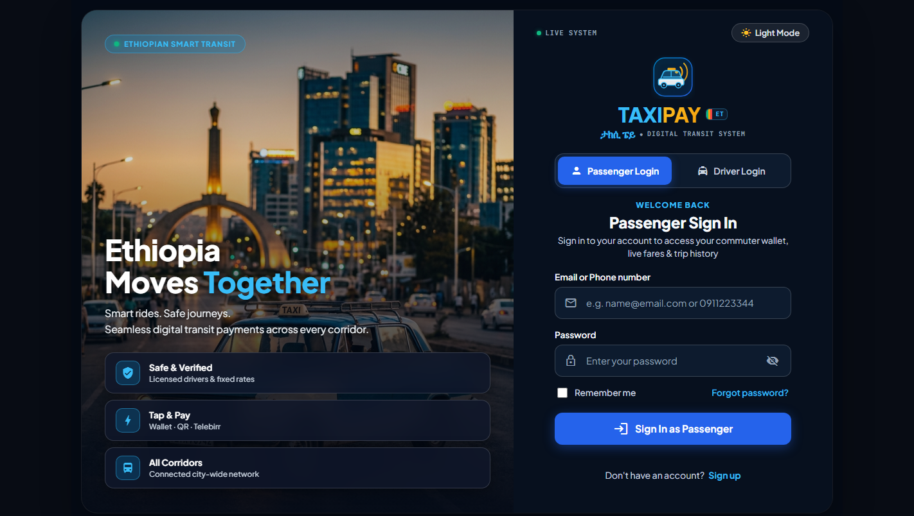
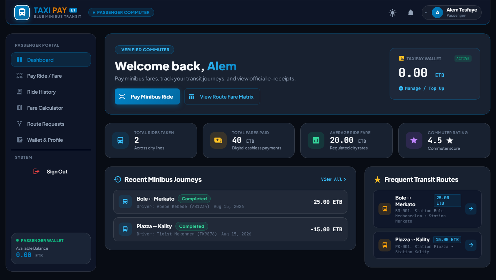
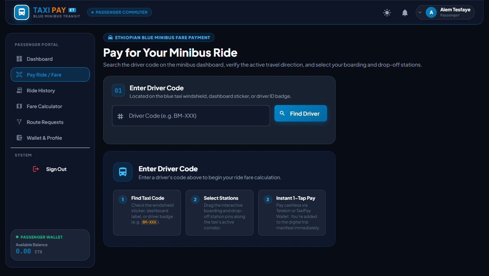
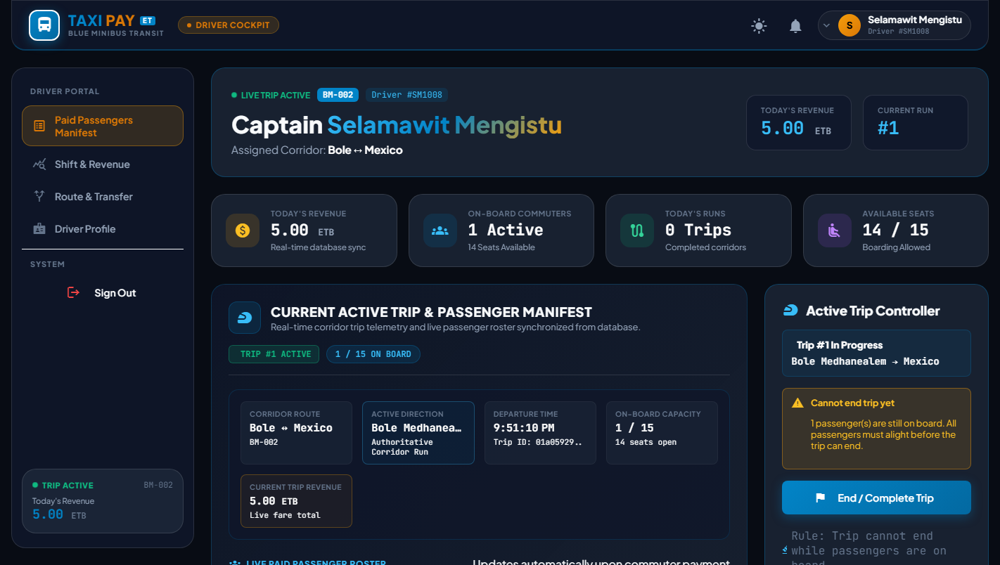
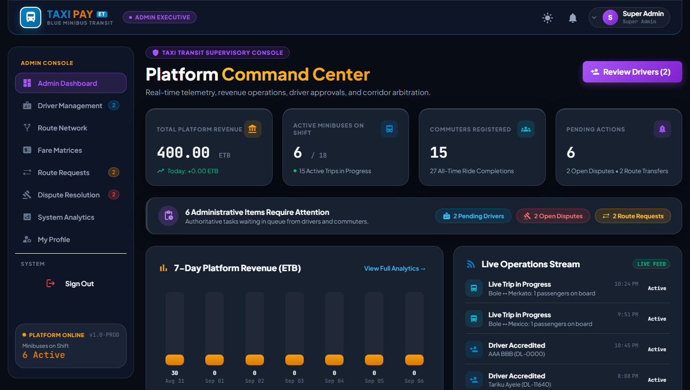

# 🚕 TaxiPay

**A cashless fare payment and fleet-management platform for shared minibus transit — built with ASP.NET Core 10 and Angular 22.**

TaxiPay digitizes the daily minibus commute: passengers find a driver by code, pay digitally before boarding, and ride cash-free — while drivers track live manifests and shift revenue, and administrators manage routes, fares, approvals, and disputes from a central console.

---

## Table of Contents

- [About the Project](#about-the-project)
  - [The Problem](#the-problem)
  - [The Solution](#the-solution)
  - [Main Users](#main-users)
- [Screenshots](#screenshots)
- [Features](#features)
  - [Passenger Features](#passenger-features)
  - [Driver Features](#driver-features)
  - [Admin Features](#admin-features)
- [User Roles](#user-roles)
- [How the System Works](#how-the-system-works)
- [Technology Stack](#technology-stack)
  - [Backend](#backend)
  - [Frontend](#frontend)
- [Architecture](#architecture)
  - [Backend — Onion Architecture](#backend--onion-architecture)
  - [CQRS with MediatR](#cqrs-with-mediatr)
  - [Frontend Architecture](#frontend-architecture)
  - [System Overview](#system-overview)
- [Project Structure](#project-structure)
- [Backend Features](#backend-features)
- [Frontend Features](#frontend-features)
- [Authentication and Authorization](#authentication-and-authorization)
- [Real-Time Features](#real-time-features)
- [State Management](#state-management)
- [Database](#database)
- [API Documentation](#api-documentation)
- [Installation](#installation)
  - [Prerequisites](#prerequisites)
  - [Clone the Repository](#clone-the-repository)
  - [Backend Setup](#backend-setup)
  - [Frontend Setup](#frontend-setup)
- [Configuration](#configuration)
  - [Environment Variables / Configuration](#environment-variables--configuration)
  - [Database Setup](#database-setup)
- [Running the Backend](#running-the-backend)
- [Running the Frontend](#running-the-frontend)
- [Testing](#testing)
- [Security Features](#security-features)
- [Key Workflows](#key-workflows)
  - [Passenger Payment Flow](#passenger-payment-flow)
  - [Driver Registration and Approval](#driver-registration-and-approval)
  - [Trip Lifecycle](#trip-lifecycle)
  - [Passenger Alighting](#passenger-alighting)
  - [Driver Route Change Request](#driver-route-change-request)
  - [Passenger Route Request](#passenger-route-request)
  - [Notifications](#notifications)
- [Future Improvements](#future-improvements)
- [Contributing](#contributing)
- [License](#license)

---

## About the Project

TaxiPay is a full-stack web platform for **shared minibus transit** (the typical city taxi/mini-bus system). Each vehicle runs a fixed route with named stops ("nodes"), charges fixed stage-based fares between stops, and collects payments from many short-distance passengers per trip.

### The Problem

Shared minibus transit still runs largely on cash:

- Drivers handle constant small cash transactions — slow boarding, theft risk, no audit trail.
- Passengers queue, carry exact change, and have no receipts or ride records.
- Operators have no visibility into per-driver revenue, route popularity, or fleet activity.
- Fares between stop combinations are enforced verbally and disputed easily.

### The Solution

TaxiPay replaces cash boarding with a **code-based, pre-paid digital flow**:

1. A passenger searches for the driver of the minibus they are boarding (by **driver code**, e.g. `DR1234`).
2. They pick their **boarding stop** and **alighting stop** from the driver's live route — the fare is resolved from the admin-managed **fare matrix**.
3. They pay instantly via **Telebirr**, **TaxiPay Wallet**, or cash, and appear on the driver's **live passenger manifest** in real time.
4. The driver manages the trip (start/complete runs, alighting confirmations) and reviews shift revenue.
5. Administrators manage the route network, fares, driver approvals, route-change requests, and disputes.

Every payment creates a **digital e-ticket receipt** and updates aggregated trip/shift/passenger statistics inside a database transaction.

### Main Users

| Role | How they interact with TaxiPay |
|---|---|
| **Passenger** | Registers, tops up a wallet, finds a driver by code, pays for a ride, tracks the active journey, confirms alighting, browses trip history and receipts, requests new routes. |
| **Driver** | Registers and gets admin approval with a unique driver code, selects a preferred route, starts/ends trips per direction, watches the live passenger manifest, requests alighting confirmations, tracks shift revenue, requests route changes. |
| **Administrator** | Signs in to a dedicated console to approve/reject drivers, manage routes and fare matrices (including symmetric reverse fares), review driver route-change requests, open/close/resolve disputes, and monitor platform analytics. |

---

## Screenshots

> Captures from a local development build (dark theme) using the seeded demo accounts. Regenerate them with `node taxipay-ui/capture-screenshots.mjs` while the API (`localhost:5205`) and frontend (`localhost:4200`) are running — the script logs in via the API, injects real sessions into headless Chrome, and saves the PNGs into `screenshots/`.

### Login Page

> The unified login page for passengers and drivers (admins use a dedicated `/admin/login` portal).

### Passenger Dashboard

> Wallet balance, active journey tracking, quick actions, and trip statistics.

### Pay Trip

> Driver code search with autocomplete, route timeline stop selection, and payment methods.

### Driver Dashboard

> Live passenger manifest, trip start/complete controls, revenue and payment breakdown.

### Admin Dashboard

> Platform analytics, driver management, routes, fares, route requests, and disputes.

---

## Features

### Passenger Features

- **Passenger registration & login** — phone-based self-service registration with JWT session issuance.
- **Passenger dashboard** — wallet balance, active journey status, recent trips, and quick actions.
- **Profile management** — update first name, last name, and phone number.
- **Wallet management & top-up** — a persistent wallet balance with topped-up funds via Telebirr.
- **Driver code search** — case-insensitive partial search over driver codes/names with debounced autocomplete.
- **Fare lookup & route timeline** — interactive boarding/alighting stop selection from the driver's active route; stops ahead of boarding only.
- **Trip payment** — pay with **Telebirr** (simulated transaction reference) or **TaxiPay Wallet** (balance debited after a funds check); the backend re-validates the driver's active trip, route nodes, and fare matrix before completing payment in a transaction. (The UI shows additional options such as CBE Birr, Card, and Cash, but the backend currently accepts only Wallet and Telebirr — see [Future Improvements](#future-improvements).)
- **Digital receipt** — an e-ticket receipt (number, route, stops, fare, transaction ref) with a QR code in the receipt dialog.
- **Active commute tracking** — the current journey store tracks boarding/alighting state in real time; passengers confirm their own drop-off.
- **Trip history** — paginated ride history.
- **Route (transfer) requests** — passengers can request new or expanded transit routes and track review status.
- **Notifications** — persistent in-app notification center with unread counts, backed by SignalR.
- **Light & dark themes** — persisted per-device, applied consistently across Angular Material overlays.

### Driver Features

- **Driver registration** — submits license number, phone, and preferred route; account starts in `Pending` status.
- **Driver approval workflow** — admins approve (assigning a driver code and confirmed route) or reject with a reason.
- **Driver codes** — a unique public code (e.g. `DR1234`) passengers use to find and pay the driver.
- **Driver dashboard** — route info, available directions, today's revenue/trips/passengers, and payment breakdown (Telebirr / Wallet / Cash).
- **Trip management** — start a trip per direction, view the current active trip, complete the trip at the route terminus (backend verifies driver location at the final stop).
- **Live passenger manifest** — real-time boarding/payment updates pushed via SignalR, seat capacity tracking, and per-passenger payment method.
- **Alighting workflow** — driver requests alighting confirmation; the passenger confirms; the manifest updates live.
- **Shift summary** — per-shift aggregated totals and completed trip runs.
- **Route change requests** — request a transfer to a different route with a reason; track admin review status.
- **Notifications** — role-targeted notifications with live unread counts.
- **Profile management** — update contact details (subject to account status).

### Admin Features

- **Dedicated admin login** — email/password sign-in at `/admin/login` with admin-specific JWT claims.
- **Admin dashboard & analytics** — platform-wide totals: passengers, active drivers, revenue, and dispute metrics.
- **Driver management** — list/filter drivers by status, view details, update status (activate/suspend).
- **Driver approval / rejection** — approve pending drivers (assigns a driver code and route) or reject with a mandatory reason.
- **Route network management** — create/update routes with ordered stop nodes (name + coordinates), activate/deactivate, and soft-delete while preserving history.
- **Fare matrix management** — per-route, per-direction stage fares in ETB, plus one-click generation of symmetric reverse-direction fares.
- **Route change request review** — approve/reject driver route transfers (blocked while the driver has an active trip).
- **Dispute resolution** — open, close, resolve, or dismiss fare/trip disputes with resolution notes; supports wallet refunds on close.
- **Notifications** — platform notifications broadcast to the admin group in real time.

---

## User Roles

TaxiPay enforces roles on both the backend (JWT role claims + policies) and the frontend (route guards):

| Role | Portal | Description |
|---|---|---|
| `Passenger` | `/passenger/*` | Commuters who pay for and take rides. |
| `Driver` | `/driver/*` | Minibus operators who run trips and collect fares. |
| `Admin` | `/admin/*` | Platform operators; sub-roles exist in the domain (`SuperAdmin`, `FareManager`, `RouteManager`, `DisputeResolver`) and are seeded as Identity roles. |
| `SuperAdmin` | `/admin/*` | Elevated admin treated with full access to driver/passenger resources. |

> Role names are accepted case-insensitively across policies (e.g. `admin`/`Admin`), and admin policies also grant drivers/passengers no implicit access — each controller declares its own allowed roles.

---

## How the System Works

At a high level, TaxiPay coordinates three parties around a **trip** on a **route**:

1. **Setup (Admin):** Administrators define routes (ordered stop nodes stored as JSONB in PostgreSQL) and a fare matrix of fixed stage fares between stop pairs. They approve driver registrations, assigning each driver a public driver code and a route.
2. **Going live (Driver):** An approved driver on an active shift starts a trip in a direction (e.g. `A→F`). The trip becomes the vehicle's *active* trip accepting passengers.
3. **Paying (Passenger):** A passenger searches the driver's code, selects boarding and alighting stops from the driver's route, and pays. The backend verifies the driver is active, on shift, and has an active trip; resolves the fare from the fare matrix; records the `PassengerJourney`; updates trip/shift/passenger aggregates; creates a receipt; and pushes the new passenger to the driver's manifest via SignalR.
4. **Riding:** The driver sees the live manifest. When a passenger is near their stop, the driver requests alighting confirmation; the passenger confirms, and both dashboards update instantly.
5. **Closing the run:** When all passengers have alighted and the vehicle reaches the final stop, the driver completes the trip. Shift summaries aggregate the day's runs.
6. **Oversight (Admin):** Disputes, route-change requests, and route/fare changes are handled in the admin console — all with real-time notifications to affected users.

---

## Technology Stack

### Backend

- **.NET 10 / ASP.NET Core** — Web API with controller-based endpoints.
- **C#** with nullable reference types.
- **Entity Framework Core 10** — ORM with code-first migrations.
- **PostgreSQL (Npgsql)** — primary datastore, including JSONB route nodes and dynamic JSON.
- **ASP.NET Core Identity** — user store, password hashing, and account lockout.
- **JWT Bearer Authentication** — stateless access tokens with SignalR query-string support.
- **MediatR** — CQRS request/response pipeline.
- **CQRS** — commands and queries with FluentValidation pipeline behaviors.
- **FluentValidation** — request validation (auto-registered from assembly).
- **AutoMapper** — domain ↔ DTO mapping profiles.
- **HybridCache** — L1/L2 caching with tagged invalidation for routes, fares, and driver lookups.
- **SignalR** — strongly-typed real-time hub with JWT auth and group-based routing.
- **OpenTelemetry** — distributed tracing and metrics (ASP.NET Core, HTTP, Npgsql) with Console and OTLP exporters.
- **Health Checks** — liveness (`/health/live`) and readiness (`/health/ready`, EF Core DB check) endpoints.
- **Rate Limiting** — tier-aware sliding-window global limiter plus strict fixed-window policies for auth, financial, and search endpoints.
- **Scalar** — OpenAPI reference UI in development.

### Frontend

- **Angular 22** — standalone components with lazy-loaded routes.
- **TypeScript 6** — strict typing.
- **Angular Signals** — fine-grained reactive state (`signal`, `computed`).
- **NgRx SignalStore** — centralized feature stores with computed selectors and lifecycle hooks.
- **RxJS** — service/stream orchestration and debounced search.
- **Angular Material + CDK** — UI component library, dialogs, snack bars, autocomplete, and themed overlays.
- **@microsoft/signalr** — real-time client with automatic reconnection and access-token factory.
- **qrcode** — QR rendering in the digital receipt dialog.
- **Vitest** — unit test runner for the Angular workspace.

---

## Architecture

### Backend — Onion Architecture

The solution follows the Onion (Clean) Architecture pattern; dependencies point inward, and the Domain layer has no outward dependencies:

```text
        ┌─────────────────────────────────────────────┐
        │                  TaxiPayApi.Api             │  Controllers, Middleware,
        │        (ASP.NET Core Web API host)          │  Rate Limiting, SignalR mapping,
        │                                             │  OpenTelemetry, Health Checks
        └──────────────────┬──────────────────────────┘
                           │ depends on
        ┌──────────────────▼──────────────────────────┐
        │           TaxiPayApi.Infrastructure         │  EF Core DbContext + Migrations,
        │      (Data access, Identity, Services)      │  JWT generation, SignalR Hub,
        │                                             │  Service implementations, Seeding
        └──────────────────┬──────────────────────────┘
                           │ depends on
        ┌──────────────────▼──────────────────────────┐
        │            TaxiPayApi.Application           │  CQRS Features (Commands/Queries),
        │        (Use cases, DTOs, Interfaces)        │  Validators, Behaviors, Mappings,
        │                                             │  Result<T,TError>, Cache keys
        └──────────────────┬──────────────────────────┘
                           │ depends on
        ┌──────────────────▼──────────────────────────┐
        │              TaxiPayApi.Domain              │  Entities, Enums, Value objects
        │         (Core business model)               │  (TaxiPayUser extends IdentityUser)
        └─────────────────────────────────────────────┘
```

**Layer responsibilities:**

| Layer | Responsibility |
|---|---|
| **Domain** | Pure business model: entities (`Driver`, `Passenger`, `Trip`, `PassengerJourney`, `Route`, `FareMatrix`, `Receipt`, `DriverShift`, `Dispute`, `RouteChangeRequest`, `PassengerRouteRequest`, `AppNotification`, `Admin`) and their status enums. |
| **Application** | Use cases organized as CQRS features under `Features/{Admins,Drivers,Passengers,Routes}`; DTOs; validators; MediatR pipeline behaviors; service interfaces (`IDriverService`, `IPassengerService`, `IAdminService`, `IRouteService`, `INotificationService`, real-time notifier contract); functional `Result<TValue, TError>` type. |
| **Infrastructure** | EF Core `TaxiPayDbContext`, entity configurations, migrations, ASP.NET Identity integration, JWT token generation, the strongly-typed SignalR hub, service implementations, and idempotent database seeding. |
| **API** | HTTP controllers, global exception handler → ProblemDetails, security headers & request logging middleware, tier-aware rate limiting, CORS for the Angular dev server, OpenTelemetry wiring, health endpoints, and startup migration + seeding. |

### CQRS with MediatR

Every use case is a small request/handler pair. Controllers translate HTTP into a MediatR request and `Match` on the functional `Result<TValue, TError>` to produce status codes:

- **Commands** mutate state (e.g. `PayTripCommand`, `TopUpWalletCommand`, `StartNewTripCommand`, `ApproveDriverCommand`, `CreateRouteCommand`).
- **Queries** read data (e.g. `GetPassengerDashboardQuery`, `GetDriverByCodeQuery`, `GetAdminAnalyticsOverviewQuery`).
- **Handlers** delegate to domain services in Infrastructure, which own EF Core logic.
- **Pipeline behavior** — a `ValidationBehavior` runs all registered FluentValidation validators before the handler executes and throws `ValidationException` on failure.
- **Caching** — query handlers (active routes, fares, driver-by-code) use `HybridCache` with tag-based invalidation from command handlers (e.g. creating a route invalidates the `routes` tag).

Example flow — paying for a trip:

```text
POST /api/passengers/{id}/pay
      │
      ▼
PassengersController ──► PayTripCommand (validated by PayTripCommandValidator)
      │
      ▼
PayTripCommandHandler ──► IPassengerService.PayForTripAsync
      │
      ▼
PassengerService (Infrastructure): verify driver/shift/trip/fare,
      write PassengerJourney + Receipt, update aggregates, commit transaction
      │
      ▼
Result<PayTripResponse, PassengerError> ──Match──► 200 OK / 4xx ProblemDetails
      │
      ▼
SignalR: driver manifest updated in real time
```

### Frontend Architecture

The Angular app is organized by feature with a `core` layer for services and state:

- **Pages** — standalone, lazy-loaded components grouped by role portal (`pages/passenger`, `pages/driver`, `pages/admin`, `pages/auth`) plus `layout` (shell, navbar, sidebar) and `shared` (route timeline, receipt dialog with QR, notification center, quick-login card).
- **Services** — HTTP API clients (`AuthService`, `PassengerService`, `DriverService`, `AdminService`, `RouteService`, `NotificationService`) and `LiveSyncService`, which owns the SignalR connection and exposes typed event streams.
- **SignalStore** — eleven NgRx SignalStores hold shared feature state (wallet, driver manifest, current journey, disputes, notifications, ride history, admin statistics/driver management/route requests, and more). Stores subscribe to LiveSync streams in `onInit` hooks so server events patch state centrally.
- **API communication** — `HttpClient` with a functional `authInterceptor` that attaches `Authorization: Bearer` headers, normalizes error messages, and force-logs-out on 401 from non-auth endpoints.
- **Authentication** — `AuthService` persists the decoded user profile in `localStorage`, decodes JWT claims to derive role and expiry, and exposes signals (`isLoggedIn`, `userRole`, `isAdmin`…). Route protection is layered: `authGuard` (session validity), `roleGuard(['admin' | 'driver' | 'passenger'])` (portal access), and `guestGuard` (redirect signed-in users away from auth pages).
- **Real-time** — `LiveSyncService` starts/stops the hub connection based on auth state, joins role/user groups, and re-broadcasts strongly-typed events (`ReceivePassengerAddedToManifest`, `ReceiveAlightingRequested`, `ReceiveTripStatusUpdated`, `ReceiveDisputeUpdated`, …) as RxJS observables consumed by stores and components.

### System Overview

```text
Angular 22 Frontend (localhost:4200)
       │
       │  HTTP REST (JWT bearer)         SignalR WebSocket (JWT via query string)
       ▼                                        ▼
ASP.NET Core 10 API  ──────────────►  TaxiPayHub (/hubs/taxipay)
       │                                        │
       ▼                                        │
Application Layer (CQRS + MediatR) ◄────────────┘  ITaxiPayRealtimeNotifier
       │
       ▼
Infrastructure Layer (EF Core, Identity, JWT, HybridCache)
       │
       ▼
PostgreSQL Database (JSONB route nodes, Identity tables)
```

---

## Project Structure

```text
TaxiPay/
├── TaxiPayApi.slnx                  # .NET solution
├── TaxiPayApi.Domain/               # Core entities & enums
│   └── Entities/
├── TaxiPayApi.Application/          # Use cases (CQRS), DTOs, interfaces
│   ├── Behaviors/                   #   ValidationBehavior (MediatR pipeline)
│   ├── Common/                      #   Result<T,TError>, errors, CacheKeys, config, telemetry
│   ├── DTOs/                        #   Admin / Auth / Drivers / Passengers / Routes / Notifications
│   ├── Features/                    #   Admins / Drivers / Passengers / Routes (Commands & Queries)
│   ├── Interfaces/                  #   Service & realtime notifier contracts
│   └── Mappings/                    #   AutoMapper profiles
├── TaxiPayApi.Infrastructure/       # EF Core, Identity, JWT, SignalR, services
│   ├── Hubs/TaxiPayHub.cs           #   Strongly-typed SignalR hub
│   ├── Migrations/                  #   EF Core migrations
│   ├── Persistence/                 #   TaxiPayDbContext + entity configurations
│   ├── Security/                    #   Resource-based authorization handlers & requirements
│   ├── Services/                    #   Driver/Passenger/Admin/Route/Notification services
│   └── SeedData.cs                  #   Idempotent dev seeding
├── TaxiPayApi.Api/                  # HTTP host
│   ├── Controllers/                 #   Auth, Passengers, Drivers, Admins, Routes, Notifications
│   ├── ExceptionHandlers/           #   GlobalExceptionHandler → ProblemDetails
│   ├── Extensions/                  #   Rate limiting, health response writer
│   ├── Middleware/                  #   SecurityHeaders, RequestLogging
│   └── Program.cs
├── TaxiPayApi.Tests/                # xUnit tests (unit + integration)
│   ├── BusinessRules/               #   Payment, alighting, trip lifecycle, wallet rules
│   ├── Integration/                 #   API contract & per-controller integration tests
│   ├── Unit/                        #   Handler & validation & fare calculation tests
│   └── Fixtures/                    #   WebApplicationFactory, test auth handler, builders
└── taxipay-ui/                      # Angular 22 frontend
    └── src/app/
        ├── core/
        │   ├── guards/              #   authGuard, roleGuard, guestGuard
        │   ├── interceptors/        #   authInterceptor (JWT + error normalization)
        │   ├── models/              #   Typed API models
        │   ├── services/            #   API clients + LiveSyncService (SignalR)
        │   └── stores/              #   NgRx SignalStores (wallet, manifest, journey, …)
        ├── layout/                  #   Shell, navbar, sidebar
        ├── pages/                   #   auth / passenger / driver / admin portals
        └── shared/components/       #   Route timeline, receipt dialog (QR), notification center
```

---

## Backend Features

- **Onion architecture** with strict dependency direction and `Result<TValue, TError>` error handling (no exceptions for expected failures; typed error codes mapped to HTTP status codes).
- **CQRS + MediatR** with a FluentValidation pipeline behavior applied to every request.
- **Global exception handling** converting unhandled errors into RFC 7807 `ProblemDetails` responses.
- **Tier-aware rate limiting** — authenticated users are partitioned by role tier (Admin 100 req/min, Driver 60, Passenger 30; anonymous 15 by IP), with stricter fixed windows on auth (5/min), financial (10/min), and search (20/min) endpoints; rejections return `429` with `Retry-After`.
- **HybridCache** for hot reads (active routes, route fares, fare lookups, driver-by-code) with per-domain TTL settings and tag-based invalidation when admins mutate data.
- **OpenTelemetry** tracing/metrics including custom business metrics (`taxipay.payments.total`, `taxipay.payments.amount`, `taxipay.trips.total`, cache hits/misses, rate-limit rejections, dispute operations) exported to Console (dev) and OTLP (configurable endpoint).
- **Health checks** — `/health/live` (process) and `/health/ready` (PostgreSQL connectivity via EF Core check).
- **Soft deletion & auditing** — `BaseEntity` provides `IsDeleted`, `DeletedAt`, `CreatedAt`, `UpdatedAt`, and a PostgreSQL row-version `Version` for concurrency; `SaveChangesAsync` maintains these automatically.
- **Database seeding** — idempotent seeding of Identity roles, demo admins/drivers/passengers, routes, fare matrices, shifts, trips, journeys, disputes, and notifications on startup (skipped in the `Testing` environment).

## Frontend Features

- **Role-based portals** with lazy-loaded standalone components and a shared shell (navbar + sidebar).
- **Centralized state** via eleven NgRx SignalStores with computed selectors (seat availability, revenue percentages, manifest counts) and server-event subscriptions.
- **Real-time UX** — manifests, wallets, journeys, disputes, route requests, and notifications update live without page refreshes; automatic reconnection re-syncs state.
- **Debounced driver-code autocomplete** with live search and SignalR trip-group subscription for live trip status while paying.
- **Route timeline component** for picking boarding/alighting stops with visual direction display.
- **Receipt dialog with QR code** for digital e-tickets.
- **Notification center** with unread badges, mark-read, and mark-all-read.
- **Theming** — dark (default) and light themes persisted in `localStorage`, synchronized with Angular Material CDK overlays.
- **Friendly error normalization** — HTTP interceptor converts backend `ProblemDetails`/validation errors into consistent, human-readable messages (including lockout 423 and rate-limit 429 cases).

---

## Authentication and Authorization

### Backend

- **ASP.NET Core Identity** stores users (`TaxiPayUser : IdentityUser`) and roles, enforces password policy (digit, lower, upper, min length 8), unique emails off, and **account lockout** (5 failed attempts → 5-minute lock).
- **JWT bearer tokens** are issued per role at login (`/api/passengers/login`, `/api/drivers/login`, `/api/admins/login`). Tokens carry role claims plus domain-identity claims (`passengerId`, `driverGuid`/`driverId`, `adminGuid`) so handlers authorize against domain entities, not just Identity user IDs.
- **Token settings** (secret, issuer, audience, access expiry hours, refresh expiry days) come from `JwtSettings` configuration; admins additionally receive a refresh token in the login response.
- **Role-based authorization** — policies (`RequireAdminRole`, `RequireDriverRole`, `RequirePassengerRole`) and per-action `[Authorize(Roles = …)]` attributes protect every controller.
- **Resource-based authorization** — four `IAuthorizationHandler` implementations (`DriverOwnsTripAuthorizationHandler`, `DriverResourceAuthorizationHandler`, `PassengerResourceAuthorizationHandler`, `PassengerJourneyAuthorizationHandler`) verify ownership of shifts, driver resources, passenger resources, and journeys — always allowing Admin/SuperAdmin through.
- **SignalR authentication** — the hub is `[Authorize]`; access tokens may arrive via the `access_token` query string; group-join methods verify the caller's own claims before joining driver/passenger/admin groups.

### Frontend

- **`AuthService`** stores the session in `localStorage`, validates expiry from the JWT `exp` claim on startup, and derives the role from token claims (never trusting client-requested roles).
- **Route guards** separate frontend navigation protection (`authGuard`, `roleGuard`, `guestGuard`) from actual backend authorization — the API always re-validates the token and ownership server-side.
- **`authInterceptor`** attaches the bearer token to every request, suppresses auto-logout for failed login attempts, and logs the user out (with session-expired messaging) when a non-auth API call returns 401.

---

## Real-Time Features

A single, strongly-typed SignalR hub (`/hubs/taxipay`) fans out domain events to role- and identity-based groups (`admins`, `drivers`, `passengers`, `user:{id}`, `passenger:{id}`, `driver:{id}`, `trip:{id}`). The frontend `LiveSyncService` manages the connection (auto-reconnect at 0s/2s/5s/10s/30s, rejoining groups after reconnect) and exposes events as observables that SignalStores subscribe to.

Implemented real-time scenarios:

```text
Passenger Pays
   ↓
Backend validates & commits transaction (journey, aggregates, receipt)
   ↓
SignalR: ReceivePassengerAddedToManifest → driver:{code|guid} group
   ↓
Driver dashboard manifest updates instantly (revenue & seat counts recompute)
```

Other wired events:

| Event | Producer | Consumers |
|---|---|---|
| `ReceivePassengerAddedToManifest` | Passenger payment | Driver manifest store |
| `ReceiveAlightingRequested` / `ReceiveAlightingConfirmed` | Driver / passenger alighting actions | Both dashboards |
| `ReceiveTripStatusUpdated` | Driver starts/completes trips | Passenger pay page, driver manifest |
| `ReceiveDriverStatusUpdated` | Admin approves/suspends driver | Driver |
| `ReceiveDriverRouteChangeSubmitted` | Driver route-change request | Admin console |
| `ReceiveRouteChangeReviewed` | Admin review | Driver |
| `ReceivePassengerRouteRequestSubmitted` | Passenger route request | Admin console |
| `ReceivePassengerRouteRequestReviewed` | Admin review | Passenger |
| `ReceiveDisputeUpdated` | Admin dispute actions | Admin console |
| `ReceiveNotificationCreated` | Notification creation | Role/user notification centers |

---

## State Management

The frontend uses **NgRx SignalStore** (signals-first stores) for anything shared beyond a single component:

- **Why** — multiple components (dashboards, dialogs, notification badge, navbar) render the same domain state; keeping it in root-provided stores prevents divergence between, say, the wallet balance shown in the navbar and the one used at payment time.
- **Stores** — `WalletStore`, `DriverManifestStore`, `CurrentJourneyStore`, `RideHistoryStore`, `NotificationStore`, `DisputeStore`, `AdminStatisticsStore`, `DriverManagementStore`, `AdminRouteRequestStore`, `DriverTransferRequestStore`, and `RouteRequestStore`.
- **Pattern** — `withState` holds normalized state; `withComputed` derives selectors (available seats, digital/cash revenue percentages); `withMethods` wraps API calls and patch state; `withHooks(onInit)` subscribes each store to its relevant `LiveSyncService` observables, so **server-pushed events and HTTP responses flow through the same state**. On SignalR reconnection, stores re-fetch their dashboards to self-heal.
- **Auth state** — `AuthService` signals (`isLoggedIn`, `userRole`, theme) back all guards and layout logic; `LiveSyncService` derives connection lifecycle from the auth signal via an `effect`.

---

## Database

- **Engine:** PostgreSQL (via Npgsql), with dynamic JSON support enabled for JSONB columns.
- **ORM:** Entity Framework Core 10 code-first with migrations applied automatically at API startup (outside the `Testing` environment).
- **Special handling:** route stop nodes are stored as JSONB (`List<Node>`); the in-memory provider (tests) uses a JSON conversion fallback.

### Important entities

| Entity | Purpose | Key relationships |
|---|---|---|
| `TaxiPayUser` | ASP.NET Identity user (`FirstName`, `LastName`, `IsActive`) | Referenced by `Driver`, `Passenger`, `Admin` via `UserId` |
| `Driver` | Driver profile, status (`Pending/Active/Suspended/Rejected`), driver code, revenue totals | Many `DriverShift`, `Trip`, `RouteChangeRequest`; assigned `CurrentRoute`/`PreferredRoute` |
| `Passenger` | Commuter profile, wallet balance, totals | Many `PassengerJourney`, `Dispute`, `PassengerRouteRequest` |
| `Admin` | Admin profile with domain sub-role (`SuperAdmin/FareManager/RouteManager/DisputeResolver`) | Reviews route-change requests and disputes |
| `Route` | Ordered stop `Node`s (JSONB), route code, active flag | Many `FareMatrix`, `DriverShift`, `Trip`, `RouteChangeRequest` |
| `FareMatrix` | Fixed fare (ETB) between two stop nodes on a route | Belongs to `Route` |
| `DriverShift` | A driver's working period on a route, aggregates passengers/revenue | Many `Trip` |
| `Trip` | One run in a direction; status (`Active/Completed/Disputed`) | Many `PassengerJourney`; one `Receipt`, optional `Dispute` |
| `PassengerJourney` | A passenger's paid segment (boarding/destination node, fare, payment, alighting state) | Belongs to `Trip` + `Passenger` |
| `Receipt` | Immutable e-ticket snapshot with receipt number and text | Belongs to `Trip`/`Passenger`/`Journey` |
| `Dispute` | Fare/trip dispute lifecycle (`Open/Reviewing/Closed/Resolved/Rejected`) | Links `Trip`, `Passenger`, `Driver`, resolving `Admin` |
| `RouteChangeRequest` / `PassengerRouteRequest` | Driver route-transfer and passenger new-route requests with review workflow | Reviewed by `Admin` |
| `AppNotification` | Persistent per-user or per-role notifications with read state | — |

All entities inherit `BaseEntity` (GUID id, timestamps, soft delete, row-version).

---

## API Documentation

The API exposes OpenAPI (`Microsoft.AspNetCore.OpenApi`) with **Scalar** as the reference UI, enabled in **development** only:

```text
Scalar UI:   http://localhost:5205/scalar
OpenAPI doc: http://localhost:5205/openapi/v1.json
```

Controllers annotate endpoints with `EndpointSummary`/`EndpointDescription` and `ProducesResponseType` metadata, so the Scalar reference documents summaries, descriptions, and response shapes per route.

---

## Installation

### Prerequisites

| Tool | Version |
|---|---|
| [.NET SDK](https://dotnet.microsoft.com/download) | 10.0 |
| [PostgreSQL](https://www.postgresql.org/download/) | 14+ (any version supported by Npgsql 10) |
| [Node.js](https://nodejs.org/) | 20.19+ (Angular 22 requirement) |
| npm | 11+ (the project pins `packageManager: npm@11.13.0`) |
| Angular CLI (optional) | `npm install -g @angular/cli` — or use `npx ng` |

### Clone the Repository

```bash
git clone <repository-url>
cd TaxiPay
```

### Backend Setup

```bash
# Restore dependencies
dotnet restore TaxiPayApi.slnx

# Apply database migrations (optional — migrations run automatically at startup)
dotnet ef database update --project TaxiPayApi.Infrastructure --startup-project TaxiPayApi.Api

# Run the API
dotnet run --project TaxiPayApi.Api
```

On startup (non-`Testing` environments) the API **migrates the database and seeds demo data** automatically: Identity roles, admin/driver/passenger accounts, routes (`Bole ↔ Merkato`, `Piazza ↔ Kality`, `Bole ↔ Mexico`), fare matrices, shifts, trips, journeys, disputes, and notifications.

Default seeded logins (development only — change them for any real deployment):

| Role | Identifier | Password |
|---|---|---|
| Admin | `admin@taxipay.com` | `Admin@123` |
| Driver | `0911122334` | `Driver@123` |
| Passenger | `0955566778` | `Pass@123` |

### Frontend Setup

```bash
cd taxipay-ui
npm install
npm start          # ng serve — dev server on http://localhost:4200
```

The Angular dev server expects the API at `http://localhost:5205` (configured in `src/environments/environment.ts`). CORS on the API allows the `http://localhost:4200` origin with credentials. There is no dev-server proxy — the frontend calls the API URL directly.

> Ensure the API is running (HTTP profile → `http://localhost:5205`) before using the UI.

---

## Configuration

### Environment Variables / Configuration

Backend configuration lives in `TaxiPayApi.Api/appsettings.json` (and `appsettings.Development.json`):

```jsonc
{
  "ConnectionStrings": {
    // Use your own credentials — do NOT commit real passwords
    "DefaultConnection": "Host=localhost;Database=TaxiPayDb;Username=YOUR_USERNAME;Password=YOUR_PASSWORD"
  },
  "JwtSettings": {
    "Secret": "CHANGE-ME-at-least-32-characters-long",  // signing key (>= 32 chars)
    "Issuer": "TaxiPayApi",
    "Audience": "TaxiPayApi",
    "AccessTokenExpiryHours": 8,
    "RefreshTokenExpiryDays": 7
  },
  "Cache": {
    "DefaultExpirationMinutes": 5,
    "RouteExpirationMinutes": 15,
    "FareMatrixExpirationMinutes": 15,
    "DriverLookupExpirationMinutes": 5
  },
  "OpenTelemetry": {
    "OtlpEndpoint": ""   // e.g. http://localhost:4317 — empty disables OTLP export
  }
}
```

The OTLP endpoint can also be supplied via the standard `OTEL_EXPORTER_OTLP_ENDPOINT` environment variable.

Frontend configuration lives in `taxipay-ui/src/environments/environment.ts`:

```ts
export const environment = {
  production: false,
  apiUrl: 'http://localhost:5205/api',
  fallbackApiUrl: 'https://localhost:7039/api',
  hubUrl: 'http://localhost:5205/hubs/taxipay'
};
```

⚠️ **Never commit real secrets, connection strings, or production JWT keys to source control.** Prefer user secrets (`dotnet user-secrets`), environment variables, or a secret manager for anything sensitive.

### Database Setup

1. Install and start PostgreSQL.
2. Create a database (e.g. `TaxiPayDb`) or let the connection string target an existing instance.
3. Set `ConnectionStrings:DefaultConnection` as shown above.
4. Run the API — migrations and seeding apply automatically; or run `dotnet ef database update` manually as shown in [Backend Setup](#backend-setup).

---

## Running the Backend

```bash
dotnet run --project TaxiPayApi.Api
```

- HTTP profile: `http://localhost:5205`
- HTTPS profile: `https://localhost:7039` + `http://localhost:5205`
- Scalar API reference (dev): `http://localhost:5205/scalar`
- Health: `http://localhost:5205/health/live` and `/health/ready`

## Running the Frontend

```bash
cd taxipay-ui
npm start
```

Open `http://localhost:4200` — you'll land on the login page. Use the seeded accounts above, or register a new passenger from the UI. Driver registrations appear in the admin console for approval.

## Testing

The backend test suite (`TaxiPayApi.Tests`, xUnit) includes:

- **Unit tests** — command handlers (admin/driver/passenger), FluentValidation command validation, and fare calculation rules.
- **Business-rule tests** — payment rules, alighting workflow, trip lifecycle, and wallet/profile invariants.
- **Integration tests** — a `WebApplicationFactory`-hosted API with an isolated **EF Core InMemory** database per test run, a **test authentication handler** (role/user claims injected via headers instead of real JWTs), a **test realtime notifier spy** capturing SignalR notifications, plus dedicated suites for API contracts, authorization boundaries, payments/wallets, trip lifecycle, and route transfers.
- **Infrastructure tests** — rate limiting, health checks, caching, and OpenTelemetry behavior.

Run everything with:

```bash
dotnet test TaxiPayApi.slnx
```

The Angular workspace ships Vitest (`ng test`) with spec files for guards, auth service, and key components:

```bash
cd taxipay-ui
npm test
```

---

## Security Features

- **JWT authentication** with issuer/audience/lifetime/signing-key validation and role claim mapping.
- **Role-based authorization** on every endpoint, with case-insensitive role acceptance and dedicated admin policies.
- **Resource-based authorization** — ownership handlers ensure passengers only touch their own wallets/journeys and drivers only their own shifts/resources (admins bypass).
- **Account lockout** — 5 failed attempts triggers a 5-minute Identity lockout; login endpoints respond `423 Locked`.
- **Rate limiting** — tier-aware global sliding windows plus strict per-policy fixed windows on auth, financial, and search endpoints; `429` responses include `Retry-After` and a ProblemDetails body.
- **Security headers middleware** — `X-Content-Type-Options`, `X-Frame-Options: DENY`, `Referrer-Policy`, `Permissions-Policy`, and a Content-Security-Policy restricting connect sources to the known API/SignalR origins.
- **Password security** — hashed by ASP.NET Core Identity with a strong default password policy; seeded passwords are development-only.
- **Input validation** — FluentValidation validators run in the MediatR pipeline before handlers; EF Core parameterization prevents SQL injection; route-node and payment-method values are validated server-side before any transaction.
- **Transactional payments** — payment writes (journey + aggregates + receipt) commit atomically; wallet debits are balance-checked first.
- **Error hygiene** — expected failures return typed error codes as ProblemDetails instead of leaking stack traces; the global exception handler controls unhandled-error output.

---

## Key Workflows

### Passenger Payment Flow

```text
Passenger
   ↓
Search Driver by Code (debounced autocomplete → GET /api/passengers/drivers/search)
   ↓
Select Driver (live trip status via SignalR driver group)
   ↓
Select Boarding Point (from driver's ordered route nodes)
   ↓
Select Alighting Point (only stops ahead of boarding)
   ↓
Fare Resolved from Fare Matrix (server-side, authoritative)
   ↓
Select Payment Method (Telebirr / Wallet)
   ↓
POST /api/passengers/{id}/pay  (rate-limited: financial-strict)
   ↓
Backend Validation: driver Active → on Active shift → Active trip → valid nodes → fare exists
   ↓
Wallet balance check & debit (if Wallet) 
   ↓
Database Transaction: PassengerJourney + trip/shift/passenger aggregates + Receipt
   ↓
Metrics recorded (payments total & amount)
   ↓
SignalR: ReceivePassengerAddedToManifest → Driver manifest updates
   ↓
Passenger receives receipt (with QR) + wallet balance refresh
```

### Driver Registration and Approval

```text
Driver registers (license, phone, preferred route) → status: Pending
   ↓
Admin lists pending drivers → approves or rejects
   ↓
Approved: driver code assigned (DR####), route confirmed, status → Active
          + SignalR ReceiveDriverStatusUpdated notifies the driver
   ↓
Rejected: mandatory rejection reason stored and surfaced to the driver
```

### Trip Lifecycle

```text
Driver on Active shift selects direction
   ↓
Start Trip (POST /api/drivers/shifts/{id}/trips/start) → trip becomes Active
   ↓
Passengers pay & board (manifest grows live; seats tracked)
   ↓
Driver requests alighting for a passenger → AwaitingConfirmation
   ↓
Passenger confirms drop-off → Alighted (removed from manifest)
   ↓
All passengers alighted + vehicle at final destination
   ↓
Complete Trip (driver location verified at destination node) → trip Completed
   ↓
Shift summary aggregates the run
```

### Passenger Alighting

```text
Driver: POST /api/drivers/journeys/{id}/request-alight
   ↓
Journey → AwaitingConfirmation + SignalR to passenger
   ↓
Passenger confirms: POST /api/passengers/{id}/journeys/{journeyId}/confirm-alight
   ↓
Journey → Alighted (AlightedAt stamped) + SignalR ReceiveAlightingConfirmed
   ↓
Driver manifest and passenger journey state update instantly
```

### Driver Route Change Request

```text
Driver submits route-change request (current route → new route + reason)
   ↓
Duplicate/active-trip guards enforced server-side
   ↓
SignalR ReceiveDriverRouteChangeSubmitted → Admin console
   ↓
Admin reviews (blocked if driver still has an active trip)
   ↓
Approved: driver reassigned · Rejected: reason recorded
   ↓
SignalR ReceiveRouteChangeReviewed → Driver
```

### Passenger Route Request

```text
Passenger submits desired From → To locations with description
   ↓
Request stored (Pending) and pushed to admins in real time
   ↓
Passenger tracks status in their route-requests page
```

### Notifications

Persistent `AppNotification` records are created per user or per role and delivered twice: read through `GET /api/notifications` (with unread counts and mark-read endpoints) and pushed live via `ReceiveNotificationCreated` to the target role/user group.

---

## Future Improvements

Ideas that fit the current architecture (not yet implemented):

- Real Telebirr/CBE Birr payment-gateway integration and full support for Cash, Card, and CBE Birr payment methods (payments are currently recorded internally with generated transaction references; the backend accepts only Wallet and Telebirr).
- Refresh-token rotation and revocation endpoints for all roles.
- GPS-based live vehicle positions on route timelines.
- Passenger driver-rating flow (rating fields exist on entities but no rating endpoint yet).
- Multi-language UI (English/Amharic).
- Redis backing layer for HybridCache and SignalR scale-out.
- CI pipeline with automated test runs and coverage reporting.

## Contributing

1. Fork the repository and create a feature branch: `git checkout -b feature/your-feature`.
2. Follow the existing architecture: new use cases belong in `TaxiPayApi.Application/Features` as command/query + validator (+ handler service logic in Infrastructure); UI features follow the pages/services/stores pattern.
3. Keep controllers thin — translate HTTP to MediatR requests and map `Result` errors to status codes.
4. Add or update tests for behavior changes and run `dotnet test` and `npm test` before opening a pull request.
5. Open a pull request describing the motivation and the change.

## License

No license file is currently included. All rights reserved by the project owner until a license is added.

---

<p align="center">Built with ASP.NET Core 10 · Angular 22 · PostgreSQL · SignalR</p>
